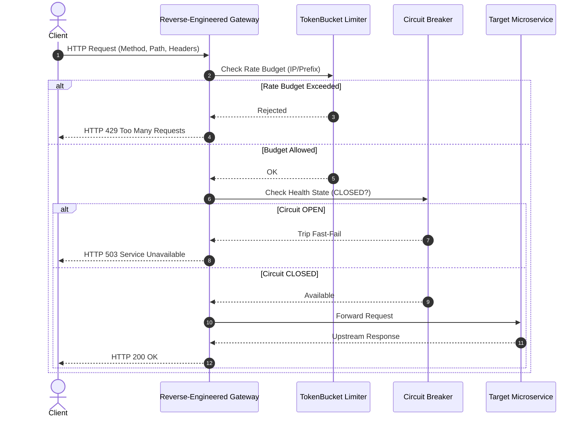

# Reverse-Engineered Resilient API Gateway

[](https://github.com/FelipeMadson/reverse-engineered-api-gateway/actions)
[](LICENSE)
[](https://github.com/FelipeMadson/reverse-engineered-api-gateway/releases)

Clean-room reverse-engineered resilient API gateway in TypeScript. Engineered from first principles with zero external runtime dependencies, native Circuit Breaker, Token Bucket rate limiting, and Bearer authentication.

## Architecture



## Key Engineering Highlights

- **Clean-Room Design**: Decoupled from legacy gateway bloatware. Detailed in [ARCHITECTURE_RECONSTRUCTION.md](ARCHITECTURE_RECONSTRUCTION.md).
- **Circuit Breaker State Machine**: Tri-state resilience (`CLOSED`, `OPEN`, `HALF_OPEN`) with automatic cooldown reset.
- **Zero Production Dependencies**: Minimal attack surface, zero supply chain vulnerabilities.

## Build & Test

```bash
npm install
npm run build
npm test
```

## Author

Developed by **[Felipe Madison](https://github.com/FelipeMadson)**.
