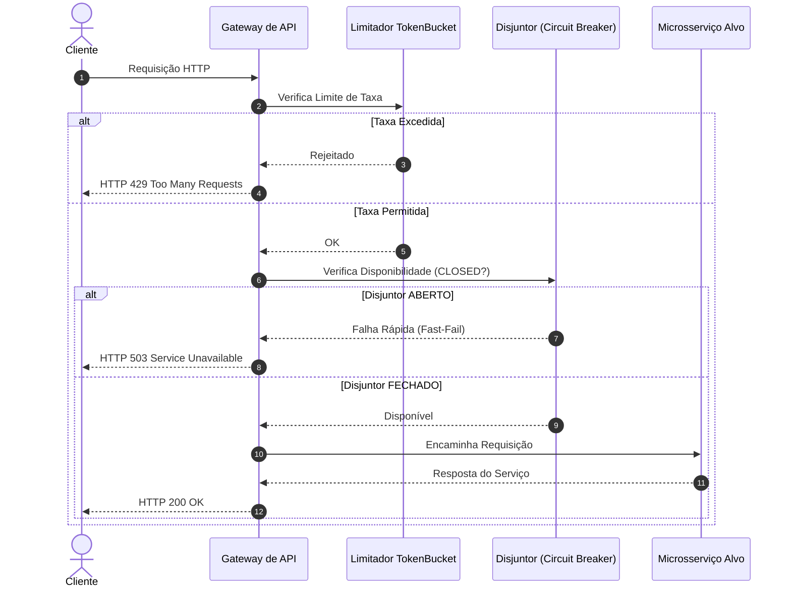

# Gateway de API Resiliente de Engenharia Reversa

[](https://github.com/FelipeMadson/reverse-engineered-api-gateway/actions)
[](LICENSE)
[](https://github.com/FelipeMadson/reverse-engineered-api-gateway/releases)

Gateway de API corporativo de alta resiliência reconstruído através de engenharia reversa clean-room em TypeScript. Desenvolvido com zero dependências de produção, Circuit Breaker nativo e controle de taxa Token Bucket.

## Diagrama de Sequência



## Destaques de Engenharia

- **Reconstrução Clean-Room**: Especificação arquitetural completa documentada em [ARCHITECTURE_RECONSTRUCTION.md](ARCHITECTURE_RECONSTRUCTION.md).
- **Disjuntor Tri-State**: Estados `CLOSED`, `OPEN` e `HALF_OPEN` com tempo de recuperação automático.
- **Zero Dependências Externas**: Máxima auditabilidade e segurança contra ataques de cadeia de suprimentos.

## Compilação e Testes

```bash
npm install
npm run build
npm test
```

## Autor

Desenvolvido por **[Felipe Madison](https://github.com/FelipeMadson)**.
